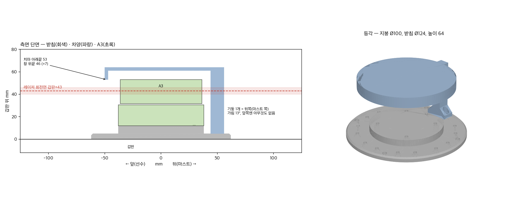

# RPLIDAR A3 받침·차양 — 물막이 1단계 (2026-10-30)

> 생성기: `python3 tools/cad/lidar_mount.py` (CadQuery) → `tools/cad/out/` → 이 폴더에 복사. 그림 `../배치도/lidar_mount_preview.png`.
> 왜: A3 는 방수가 아닌데 선수 끝(물보라 1순위)에 앉는다. **막는 게 아니라 덜 젖게** 하는 것 — `마스트_요구사항.md` §2-1.
> A3 치수 출처: Slamtec RPLIDAR A3M1 datasheet v1.2 Figure 5-1 (Ø76, 높이 41, 레이저 창 중심 31, 바닥 4×M3 R29.5).

## 0. 결론

| 파일 | 무엇 | 크기 |
|---|---|---|
| `lidar_fit.stl` | **먼저 뽑는다.** 받침 윗판만 3 mm — 실물 A3 를 얹어 나사 4개·맞춤 핀 확인 | Ø76 × 4 |
| `lidar_base.stl` | 받침: 갑판에서 12 mm 띄움, 갑판 볼트 4, 차양 자리 8곳 | Ø124 × 13 |
| `lidar_hood.stl` | 차양: 지붕 Ø100 + 치마, **기둥 1개는 뒤쪽(마스트 쪽)** | 106 × 100 × 59 |

생성기가 매번 확인하는 것(10-30 출력):
- 레이저 회전면 = **갑판 + 43 mm** (갑판 직치 31 대비 +12).
- 치마 아래끝 53 > 레이저 창 위끝 46 → **빔 안 가림**(여유 7 mm).
- 기둥이 가리는 각도 13°, 뒤쪽만. 코드는 앞쪽만 쓴다(ship_direction ±80°, 나머지 노드는 카메라 방위 근처 또는 전방 섹터).
  기둥은 A3 에서 44 mm — A3 최소 측정거리보다 가까워 **가짜 장애물로 안 찍힌다**(그 방향이 비어 보일 뿐).
- 간섭 없음, 나사 물림 OK.

## 1. 프린트

- 재질 **PETG 또는 ASA, 밝은 색** (PLA 금지 — 여름 갑판에서 처짐, 마스트와 같은 이유). 벽 4, 인필 40 %.
- `lidar_base` — 그대로(플랜지가 바닥). 받침 없이 나온다.
- `lidar_hood` — **뒤집어서(지붕이 바닥)**. 발 쪽은 45° 경사라 받침 없이 나온다.
- `lidar_fit` — 그대로. 10 분 남짓.

## 2. 부품

| 어디 | 나사 | 수량 | 🚨 |
|---|---|---|---|
| A3 ↔ 받침 | **M3×6** | 4 | **M3×8 금지** — 데이터시트: 4 mm 넘게 물리면 내부 모듈 손상. 윗판 3 + 물림 3 |
| 차양 ↔ 받침 | M3×8 + M3 육각너트 | 2 + 2 | 너트는 받침 바닥의 육각 홈에 **갑판에 붙이기 전** 넣는다. M3×10 은 바닥으로 튀어나와 갑판에 닿는다 |
| 받침 ↔ 갑판 | M4 + 와셔·너트 | 4 | 길이 = 5(플랜지) + 갑판 두께 + 10 |

## 3. 조립 순서

1. **`lidar_fit` 으로 맞춤 확인** — A3 바닥에 대고 핀이 위치결정 구멍(Ø3)에, 구멍 4개가 나사 자리에 맞는지. 핀이 안 맞으면 칼로 깎아도 된다.
2. 받침 위에 A3 를 핀에 맞춰 얹고, **아래에서** Ø7 구멍으로 M3×6 4개. (핀 = 0°, 케이블은 반대쪽 180° 로 나온다)
3. 차양 기둥을 둘 자리 결정: 8곳 중 **마스트 쪽(뒤)** 한 곳. 그 자리의 너트 홈 2개에 M3 너트를 넣는다.
4. 받침을 갑판 선수 끝 중심선에 놓는다. **A3 의 정면 방향은 지금까지 달던 방향 그대로**(코드 `LIDAR_FORWARD_DEG = 80`). 갑판에 M4 구멍 4개 뚫고 고정.
5. 차양을 그 자리에 얹고 M3×8 2개.
6. 케이블: 커넥터를 자기융착 테이프로 감고, 선은 한 번 아래로 처지게(드립 루프) 해서 갑판 관통부로.

## 4. 달고 나서 확인

- [ ] launch 후 정면 1 m 에 물체 → `/scan` 에서 80° 근처에 1 m (정면이 바뀌지 않았나)
- [ ] 360° 돌려 봐도 앞쪽 ±80° 안에 가까운 가짜 점 없음
- [ ] 수조: 물보라가 A3 까지 오는 높이 기록(`마스트_요구사항.md` §2-1 "진수 후 선수 물보라 도달 높이")
- [ ] 젖었으면 전원 끄고 완전히 말린 뒤 켠다

## 5. 고칠 수 있는 값 (`tools/cad/lidar_mount.py` 맨 위)

- `PED_H` 12 — 띄우는 높이. 부표가 낮으면 줄인다(최소 ≈ 7: 나사머리 + 드라이버 여유). 회전면이 그만큼 내려간다.
- `GAP_TOP` 8, `ROOF_R` 50 — 지붕 높이·크기. 바꾼 뒤 출력의 "빔 안 가림" 줄이 OK 인지.
- `POST_W` 10 — 기둥 폭 = 가리는 각도.

## 6. 이 단계가 못 하는 것

- 아래·옆에서 튀는 물보라는 지붕이 못 막는다 → 선수 **스프레이 레일**(선체 모양에 따라 따로).
- 회전 헤드와 베이스 사이 1 mm 틈은 구조상 막을 수 없다.
- 이걸로 부족하면 2단계(회전축과 같은 중심의 투명 원통) 또는 3단계(IP65 LiDAR).
