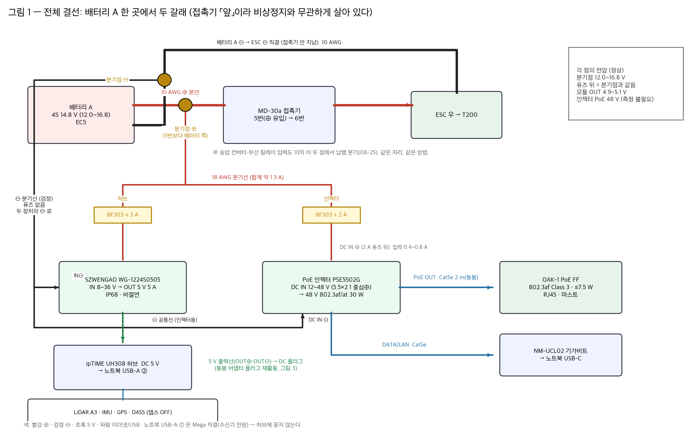
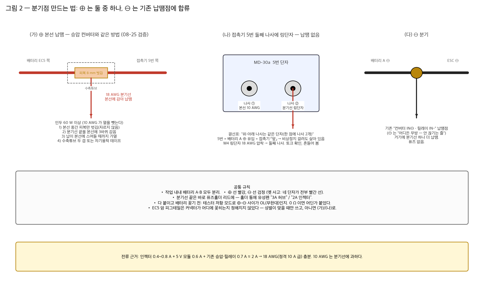
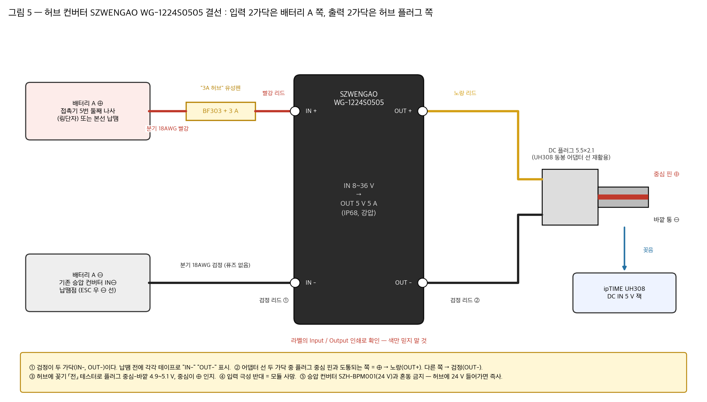
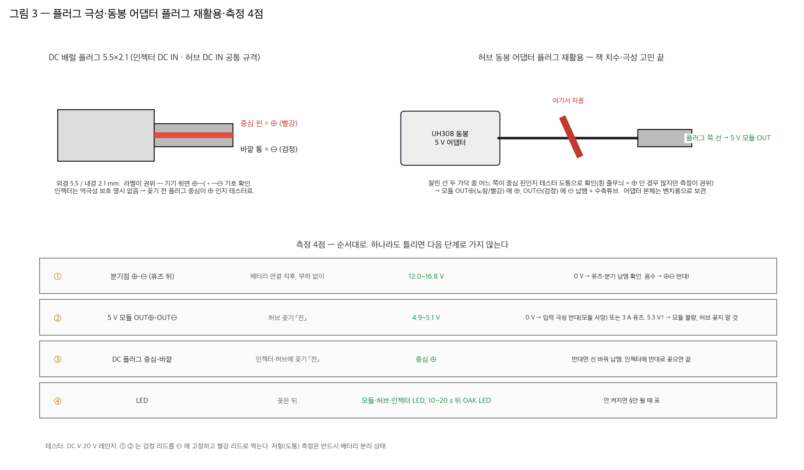
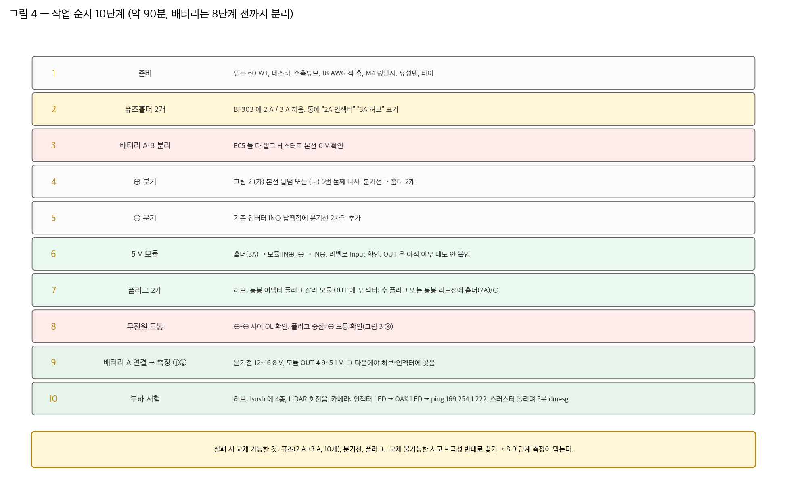

# 허브·카메라 전원 분기 설명서 — 4S 배터리 A 에서 두 갈래 (2026-10-26)

> 손으로 하는 순서. 근거(사양 대조·위험 분석)는 `허브_카메라_전원_검증_20261026.md`, 소프트 쪽(IP·토픽·hfov)은 `oak_arrival_runbook.md`.
> 그림 재현: `python3 tools/power_branch_manual.py` → `docs/절차/그림/전원분기_*.png`

## 0. 결론 먼저

- 배터리 A(4S 12.0~16.8 V) 한 곳에서 **⊕·⊖ 각 한 점**을 따서 두 갈래로 나눈다: **3 A 퓨즈 → 5 V 모듈 → 허브**, **2 A 퓨즈 → PoE 인젝터 → OAK**.
- 분기점은 **접촉기 5번보다 배터리 쪽** — 승압 컨버터·무선 릴레이가 이미 거기서 납땜으로 분기돼 있다(08-25, 09-07 물 위 통과). 같은 자리, 같은 방법.
- 전압·전력·규격 전부 맞는다. 재구매가 필요해지는 사고는 **극성 반대로 꽂는 것** 하나뿐이고, 그림 3 의 측정 4점이 그걸 막는다.

## 1. 준비물

| 분류 | 품목 | 비고 |
|---|---|---|
| 공구 | 인두 **60 W 이상**, 테스터(DC V·도통), 니퍼·스트리퍼, 압착기(링단자 쓸 때), 드라이버 | 10 AWG 본선은 열을 많이 뺏는다 |
| 선·소모품 | 18 AWG 적·흑 각 1 m, 수축튜브(3·5 mm), M4 링단자 1개(선택), 유성펜, 케이블타이 | 분기선 합계 약 2 A → 18 AWG 충분 |
| 부품(도착) | BF303 홀더 2, 5×20 퓨즈 2 A·3 A, SZWENGAO WG-1224S0505, UH308 + 동봉 5 V 어댑터, OAK-1 PoE + 동봉 Cat5e 2 m, NM-UCL02 | 10-26 기준 |
| 부품(미도착) | PSE5502G 인젝터(G마켓 재발주), 3 A 퓨즈, DC 수 플러그 | 허브 계통은 인젝터 없이 먼저 된다. 플러그는 §4 로 대체 가능 |

## 2. 분기점 만들기

**⊕ — 둘 중 하나**
- (가) 본선 납땜: 배터리 EC5 와 접촉기 5번 사이 10 AWG 본선 중간 피복만 8 mm 벗기고(자르지 않음), 18 AWG 분기선 끝을 3바퀴 감아 납이 본선에 스며들 때까지 가열. 수축튜브 두 겹.
- (나) 링단자: MD-30a 5번 단자는 한 점에 나사가 2개. 둘째 나사에 M4 링단자(18 AWG 압착). 납땜 없음. 조이고 흔들어 확인.

**⊖** — 기존 "컨버터 IN⊖ · 릴레이 IN-" 납땜점에 분기선 2가닥 더 납땜. ⊖ 는 접촉기를 안 지나는 줄이라 어디든 무방. 퓨즈 없음.

**배터리 선택** — 두 갈래 다 A 에 둔다(기본). 허브 갈래를 B 에 둬도 된다(B ⊕ = 접촉기 2번 둘째 나사, B ⊖ = ESC 직결선). 차이는 시간당 6 % vs 21 % 불균형뿐이라 어느 쪽이든 무방(팀 결정 10-26).

**EC5 암 피그테일 ×3** — 커넥터가 어디 꽂히는지 설계에 없다. 배터리 쪽 커넥터와 성별이 같으면 꽂을 데가 없다. 성별이 맞을 때만 Y 로 쓰고, 아니면 (가)/(나). 결선 성립과 무관.

## 3. 퓨즈홀더

1. BF303 통을 돌려 열고 5×20 유리관이 딸깍 들어가는지 본다.
2. 하나 **2 A → "2A 인젝터"**, 하나 **3 A → "3A 허브"** 유성펜. 겉이 똑같다.
3. 퓨즈는 극성 없음. ⊕ 선에만 넣는다.
4. 2 A 가 인젝터 켤 때 끊기면(돌입전류) **3 A 로 교체** — 정상 입력 0.4~0.8 A 라 3 A 도 보호 역할을 한다.

## 3-1. 허브 컨버터 리드 4가닥

## 4. 플러그 — 동봉 어댑터 플러그를 잘라 쓴다

- 허브: UH308 동봉 5 V 어댑터 선을 플러그에서 20 cm 남기고 자른다. 어느 가닥이 중심 핀인지 **도통으로 확인** 후 5 V 모듈 OUT⊕/OUT⊖ 에 납땜. 잭 치수·극성 고민이 사라진다. 어댑터 본체는 벤치용.
- 인젝터: 동봉 리드선이 있으면 그것, 없으면 **티놀지 세트의 수 플러그(5.5×2.1, 10-27 도착)**. 중심 ⊕ 확인 후 홀더(2 A) 와 ⊖ 분기선에 납땜. 세트의 암 잭은 벤치 측정용.
- 인젝터는 **역극성 보호가 명시돼 있지 않다.** 꽂기 전 플러그 중심이 ⊕ 인지 테스터.

## 5. 측정 4점 — 하나라도 틀리면 다음으로 안 간다

| # | 어디 | 언제 | 정상 | 아니면 |
|---|---|---|---|---|
| ① | 분기점 ⊕–⊖ (퓨즈 뒤) | 배터리 A 연결 직후, 부하 없이 | 12.0~16.8 V | 0 V → 퓨즈·납땜. 음수 → ⊕⊖ 반대 |
| ② | 5 V 모듈 OUT⊕–OUT⊖ | 허브 꽂기 **전** | 4.9~5.1 V | 0 V → 입력 극성 반대(모듈 사망) 또는 3 A 퓨즈. 5.3 V 이상 → 허브 꽂지 말 것 |
| ③ | DC 플러그 중심–바깥 | 꽂기 **전** | 중심 ⊕ | 선 바꿔 납땜 |
| ④ | LED | 꽂은 뒤 | 모듈·허브·인젝터 LED, 10~20 s 뒤 OAK LED | §7 |

테스터 DC 20 V 레인지. 도통(저항) 측정은 반드시 배터리 분리 상태.

## 6. 작업 순서

## 7. 안 될 때

| 증상 | 먼저 볼 것 |
|---|---|
| 5 V 모듈 OUT 0 V | 입력 극성(라벨 Input). 3 A 퓨즈 통 열어 확인 |
| 허브 LED 꺼짐 | 플러그 중심 극성. OUT 전압 |
| 허브 켜졌는데 LiDAR 안 돎 | 기동 1.5 A 를 포트가 못 줌 → 충전전용 포트(5 V 2 A)에서 전원만 따는 USB Y 케이블. 노트북 직결 때 4.70 V 였으니 허브가 오히려 낫다 |
| 허브 켜졌는데 장비 안 보임 | 업스트림이 USB-A ② 인가. `dmesg | tail` |
| 인젝터 LED 안 켜짐 | 2 A 퓨즈(돌입 → 3 A). DC IN 극성. 입력 12 V 이상인가 |
| 인젝터 켜졌는데 OAK LED 없음 | PoE/DATA 포트 바뀜. Cat5e 양 끝 딸깍. 20 s 더 |
| OAK LED 켜졌는데 ping 실패 | 노트북 169.254.1.10/16, ufw 11490/11491 — 런북 §3 |
| 스러스터 돌리면 USB 끊김 | 모듈 OUT 에 전해 1000 µF + 페라이트. `dmesg` 로 확인 |
| 배터리 12.5 V 아래 | 인젝터 하한 12 V — 비전 끊길 수 있음. 교체 |

## 8. 끝났다는 기준

> **10-28 1번배 허브 계통 결과 (Ubuntu 확인)**: 5V 컨버터 출력 5 V ✅ · 허브 LED ✅ · 허브 아래 장치 인식 ✅ —
> 라이다 80BF(`/dev/ttyLiDAR`, 10.4 Hz, 간격 최대 100 ms, Stop motor 정상) · IMU(`/dev/IMU`, 100 Hz) ·
> D455(USB 3.2, **30 fps** 간격 최대 35 ms — camera_info 기준) · GPS ZED-F9P(`/dev/ttyGPS`, /fix 1 Hz, 실내라 측위 없음). 아두이노는 노트북 직결.
> 🚨 **처음엔 허브 아래 장치가 하나도 안 잡혔다** — UH308 **포트별 전원 버튼**이 꺼져 있었다. 커널 로그에 연결 시도조차 없으면 포트 LED·버튼부터.
> ⏳ 남은 것: 스러스터 부하 중 USB 끊김 시험, 인젝터 갈래(배송 중).

- [ ] 분기점 12~16.8 V, 모듈 OUT 4.9~5.1 V 기록
- [ ] `lsusb` 에 LiDAR·IMU·GPS·D455, LiDAR 회전음
- [ ] 인젝터 LED → OAK LED → `ping 169.254.1.222` 통과
- [ ] 스러스터 풀스로틀 5분 동안 `dmesg` 에 USB 재연결 없음
- [ ] 퓨즈홀더 2개가 손 닿는 자리에 라벨 위로 고정
